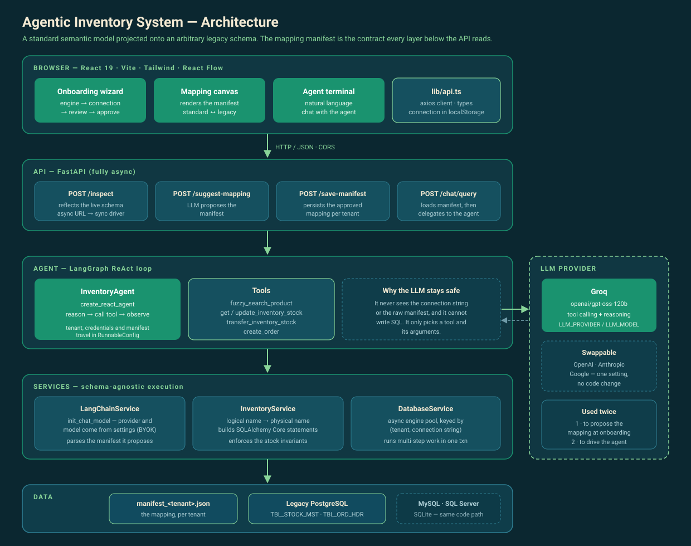

# Agentic Inventory System

Point it at a legacy inventory database — whatever the tables are called — and ask
it questions in English.

The problem it solves is that real inventory data lives in schemas nobody would
design today: `TBL_STOCK_MST`, `C_ITEM_CD`, `N_QTY_ON_HAND`. The usual answer is a
migration. This takes the other route: an LLM reads the real schema, proposes how
it maps onto a standard model, a human approves that mapping on a canvas, and from
then on a LangGraph agent answers questions and performs operations against the
database as it already is.

The mapping is the whole trick. Everything below the API reads a **mapping
manifest** instead of hardcoding a table or column name, so the same code path
serves PostgreSQL, MySQL, SQLite and SQL Server against four completely different
schemas.



## What's actually built

- **Onboarding** — connect, reflect the real schema, let the model propose a
  mapping, review and correct it on a React Flow canvas, approve it. Runs once per
  database; approved databases reconnect from the landing screen in one click.
- **Inventory assistant** — a chat screen over a LangGraph ReAct agent. Check
  stock, search by description, adjust a quantity, transfer between locations,
  raise an order. The agent never writes SQL and never sees the connection
  string: tenant, credentials and manifest are injected through `RunnableConfig`.
- **Four SQL engines, one code path** — statements are built with SQLAlchemy Core
  from logical names, so dialect differences (bracket quoting, identifier case,
  parameter style) never reach the application.
- **Transaction safety** — a transfer is two updates in one transaction, and the
  deduction is guarded in SQL (`WHERE quantity >= :amount`) rather than by a
  read-then-write check, so concurrent transfers can't drive a location negative.

## Documentation

| | |
|---|---|
| [docs/ARCHITECTURE.md](docs/ARCHITECTURE.md) | How it fits together and what happens on each request, with diagrams |
| [docs/stress-test-report.txt](docs/stress-test-report.txt) | 111 checks across the four engines — injection, rollback, concurrency, prompt injection — plus the three defects the testing found |
| [docs/engine-test-report.txt](docs/engine-test-report.txt) | Onboarding and querying three engines through the API |
| [docs/fixtures/](docs/fixtures/) | Seed scripts for the four demo databases |

## Stack

**Backend** — FastAPI, SQLAlchemy 2.0 async Core, LangChain + LangGraph
(`create_react_agent`), Pydantic v2. The model is configuration: `init_chat_model`
is handed a provider and model name from settings, so Groq, OpenAI, Anthropic and
Google all work without a code change.

**Frontend** — React 19, Vite, TypeScript, Tailwind, `@xyflow/react` for the
mapping canvas, React Router, axios.

## Running it

Two terminals. You'll need a provider API key and a database to point at.

### Backend

```bash
cd backend
python -m venv .venv
.venv\Scripts\activate          # Windows
# source .venv/bin/activate     # macOS / Linux
pip install -r requirements.txt

cp .env.example .env            # then fill in one provider key
uvicorn app.main:app --reload
```

Runs on http://localhost:8000 — `/docs` for the OpenAPI UI.

SQL Server additionally needs Microsoft's ODBC Driver 18 installed on the host
before `pyodbc` can see it (`winget install --id Microsoft.msodbcsql.18`); the
other three engines need nothing beyond `pip install`.

### Frontend

```bash
cd frontend
npm install
npm run dev
```

Runs on http://localhost:5173.

### A database to try it on

If you don't have a legacy schema lying around, `docs/fixtures/` has four seeded
to deliberately awkward naming conventions. The quickest is SQLite, which needs no
server:

```bash
cd backend
python -c "import sqlite3,io; sqlite3.connect('dublin_ops.db').executescript(io.open('../docs/fixtures/seed_sqlite.sql',encoding='utf-8').read())"
```

Then onboard `sqlite+aiosqlite:///dublin_ops.db` and ask how many hex bolts you
have. The answer is 2,250, and nothing in the application knows that the column is
called `on_hand_qty`.

The other three need a server. These are the containers the fixtures were built
against — choose your own passwords and reuse them in the connection string:

```bash
# PostgreSQL
docker run -d --name inv_test_pg -p 5433:5432 \
  -e POSTGRES_USER=invtest -e POSTGRES_PASSWORD=<password> -e POSTGRES_DB=legacy_inventory \
  postgres:16-alpine
docker exec -i inv_test_pg psql -U invtest -d legacy_inventory < docs/fixtures/seed_postgres.sql

# MySQL
docker run -d --name inv_test_mysql -p 3307:3306 \
  -e MYSQL_ROOT_PASSWORD=<root-password> -e MYSQL_DATABASE=berlin_inventory \
  -e MYSQL_USER=invtest -e MYSQL_PASSWORD=<password> \
  mysql:8.0
docker exec -i inv_test_mysql mysql -uinvtest -p<password> berlin_inventory < docs/fixtures/seed_mysql.sql

# SQL Server. Needs the ODBC driver above, and the seed runs as sa because it
# creates the database; the app then connects as its own login.
docker run -d --name inv_test_mssql -p 1434:1433 \
  -e ACCEPT_EULA=Y -e MSSQL_SA_PASSWORD='<sa-password>' -e MSSQL_PID=Express \
  mcr.microsoft.com/mssql/server:2022-latest
docker cp docs/fixtures/seed_mssql.sql inv_test_mssql:/tmp/seed.sql
docker exec inv_test_mssql /opt/mssql-tools18/bin/sqlcmd \
  -S localhost -U sa -P '<sa-password>' -C -i /tmp/seed.sql
docker exec inv_test_mssql /opt/mssql-tools18/bin/sqlcmd \
  -S localhost -U sa -P '<sa-password>' -C -d nordic_wms -Q \
  "CREATE LOGIN invtest WITH PASSWORD='<password>'; CREATE USER invtest FOR LOGIN invtest; ALTER ROLE db_owner ADD MEMBER invtest;"
```

SQL Server refuses a password containing the account name, so that one cannot be
a variation on `invtest`. Then onboard, with the passwords you chose:

```
postgresql+asyncpg://invtest:<password>@localhost:5433/legacy_inventory
mysql+aiomysql://invtest:<password>@localhost:3307/berlin_inventory
mssql+aioodbc://invtest:<password>@localhost:1434/nordic_wms?driver=ODBC+Driver+18+for+SQL+Server&TrustServerCertificate=yes
```

A password holding URL-reserved characters has to be percent-encoded there —
`!` becomes `%21`.

Each fixture uses a different naming convention and holds a different quantity of
stock, so the same question has four different correct answers. That is the point:
the answer tells you which database was actually queried.

## Limitations

This is a working demonstration of an architecture, not a deployable product. The
gaps are deliberate and worth naming:

- **No authentication.** `tenant_id` arrives in the request body and is trusted.
  Anyone who can reach the API can act as any tenant.
- **CORS is wide open** (`allow_origins=["*"]`) to keep local development
  frictionless.
- **Connection strings live in the browser's `localStorage`**, passwords included.
  A real deployment would hold them server-side against an authenticated user.
  Approved manifests are already keyed by a SHA-256 fingerprint of the URL with
  the password stripped, so no credential is written into a filename.
- **Manifests are JSON files on disk**, keyed by tenant and connection.
- **No retry on a deadlock.** Opposed concurrent transfers between the same two
  rows deadlock on PostgreSQL and SQL Server; data stays correct and no balance
  goes negative, but the losing request fails and nothing retries it. Measured
  across all four engines in the stress report.
- **The engine cache has no eviction** — correct for a handful of databases, a
  connection-pool leak for many tenants.
- **Search is substring matching**, widened with singular stems. It is not
  semantic, and it will miss a synonym.
- **MongoDB and DynamoDB** appear on the engine screen as placeholders. The
  manifest abstraction is the part that would have to change, not the agent.

## License

MIT — see [LICENSE](LICENSE).
