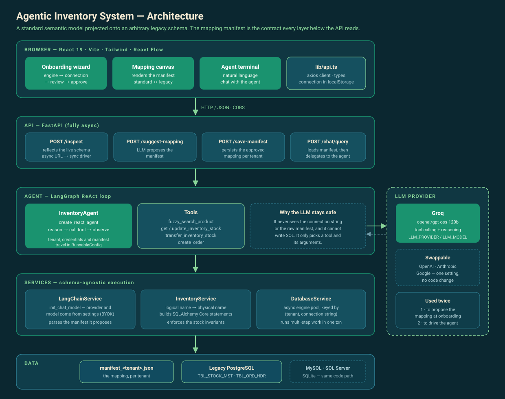
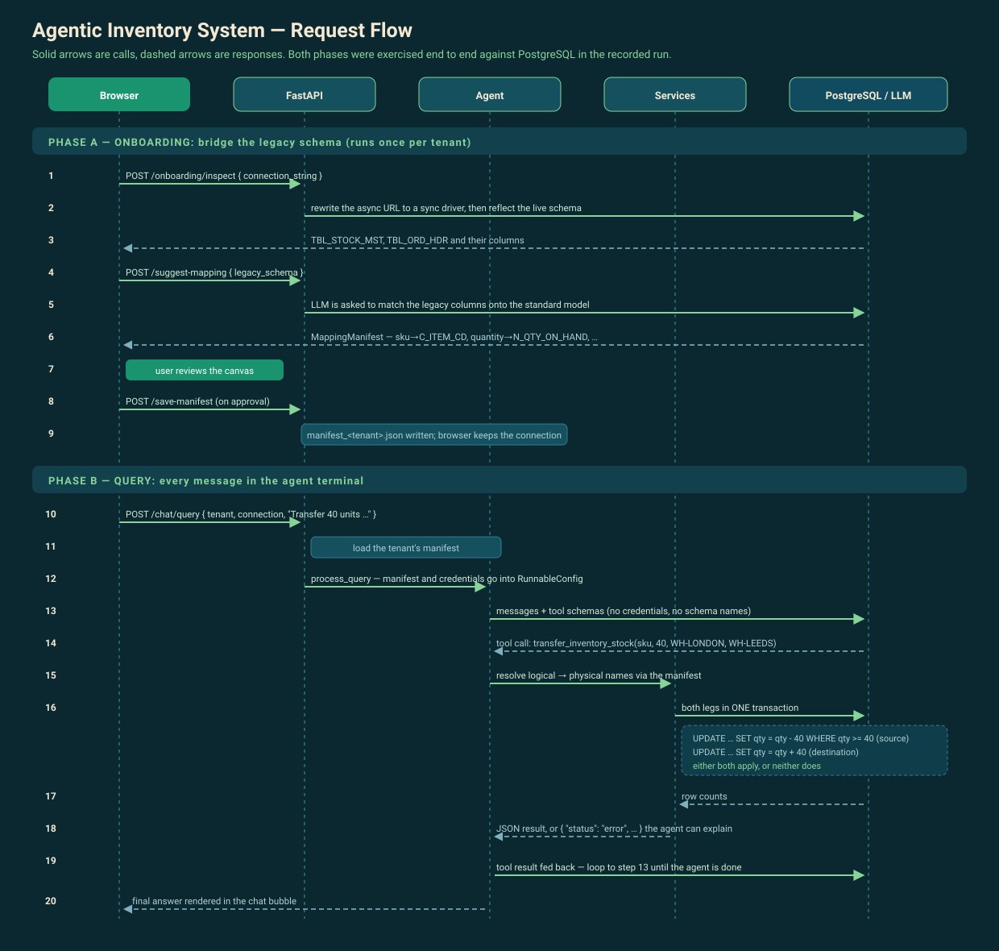

# Architecture & Flow

How the Agentic Inventory System is put together, and what happens on each request.

## Architecture



The system is a thin stack over one idea: a **mapping manifest** that says how our standard
model (`inventory`, `orders`) maps onto whatever the legacy database actually calls things
(`TBL_STOCK_MST`, `C_ITEM_CD`, `N_QTY_ON_HAND`). Everything below the API reads that manifest
instead of hardcoding table or column names.

| Layer | Responsibility |
|---|---|
| **Browser** | Onboarding wizard, the React Flow mapping canvas, and the inventory assistant. `lib/api.ts` is the only place that talks to the API; the connection string is captured during onboarding and kept in `localStorage`, alongside the list of already-onboarded databases in `lib/connections.ts`. |
| **API** (FastAPI) | Five endpoints: reflect a schema, propose a mapping, save it, report whether one already exists, answer a query. No business logic. |
| **Agent** (LangGraph) | A ReAct loop. The LLM chooses a tool and its arguments; it never writes SQL and never sees the connection string, because tenant, credentials and manifest are injected through `RunnableConfig`. |
| **Services** | `LangChainService` builds the model from settings (provider is configuration, not code). `InventoryService` turns logical names into physical ones and builds SQLAlchemy Core statements. `DatabaseService` owns the async engine pool and transaction boundaries. |
| **Data** | One manifest per tenant *and* connection, plus the customer's own database. All four SQL engines (PostgreSQL, MySQL, SQLite and SQL Server) are exercised through the same code path, against four different legacy schemas. |

## Request flow



**Phase A (onboarding)** runs once per database: inspect the real schema, let the LLM propose
a mapping, show it on the canvas, and persist it once the user approves. A manifest describes
one specific schema, so `manifest_store` keys it by tenant *and* a fingerprint of the
connection. The fingerprint comes from the URL with its password stripped, so rotating a
credential does not orphan the mapping and no secret lands in a filename. Approved databases are then listed on the landing
screen and reconnect in one click, skipping this phase entirely.

**Phase B (query)** runs for every chat message: load the manifest, let the agent reason and
call tools, execute dialect-independent SQL, and feed the result back into the loop until the
agent has an answer.

The transaction boundary in step 16 is the important one. A transfer is two updates; they
either both apply or neither does, and the deduction is guarded in SQL
(`WHERE quantity >= :amount`) so concurrent transfers cannot drive a location negative.

## Every engine, one code path

Calling the system schema- and dialect-agnostic is worth nothing unless more than one
engine is actually exercised, so all four are onboarded: PostgreSQL, MySQL, SQLite and
SQL Server.

Each fixture deliberately uses a **different legacy naming convention** and holds a
**different quantity of stock**. Ask all four the same question and four different correct
answers come back, which shows two things at once: the mapping adapted to that schema, and
the agent queried that database rather than another one.

| Engine | Database | Legacy tables | Columns look like | Hex bolts |
|---|---|---|---|---|
| PostgreSQL 16 | `legacy_inventory` | `TBL_STOCK_MST`, `TBL_ORD_HDR` | `C_ITEM_CD`, `N_QTY_ON_HAND` | 8,950 |
| MySQL 8.0 | `berlin_inventory` | `inv_master`, `ord_lines` | `itm_sku`, `qty_avail` | 4,400 |
| SQLite 3 | `dublin_ops.db` | `stock_ledger`, `purchase_orders` | `part_number`, `on_hand_qty` | 2,250 |
| SQL Server 2022 | `nordic_wms` | `[Stock Levels]`, `[Order Header]` | `[Item No]`, `[Qty On Hand]` | 6,125 |

The SQL Server fixture is the hostile one: every table and column name contains a space,
on the one dialect of the four that quotes identifiers with brackets rather than quotes.
Nothing in the application hardcodes either. SQLAlchemy Core is handed logical names and
emits whatever that dialect requires.

Reconnecting to a database onboarded several databases ago still resolves against its own
schema: PostgreSQL answers 8,950, not the 2,250 of whichever database was mapped most
recently. That is what per-connection manifests buy.

[`engine-test-report.txt`](./engine-test-report.txt) drives the first three engines through
the API rather than the UI: reflect, map, save, then read, transfer, re-read and create an
order against each, with every write verified in the database afterwards.

## When things go wrong

The happy path is the easy half. [`stress-test-report.txt`](./stress-test-report.txt) is
**111 checks across the four engines**, split into two suites:

- a **deterministic suite** that drives the service layer directly, with no model in the
  loop, so a failure points at our code rather than at a model's choice of words;
- an **agent suite** that goes through the HTTP API with the LLM reasoning, and reads the
  database directly after anything that could have written to it, so a confidently worded
  wrong answer is caught even when the prose reads well.

What they cover: over-deduction and over-transfer refusals, transaction rollback, the
concurrency guard, SQL injection through both SKUs and search terms, prompt injection from
the user's message *and* from the stored data, unicode round trips, credential and
connectivity failures, and manifest isolation between databases.

Two are worth singling out. **Rollback** is tested honestly: the SQL Server fixture holds
two stock rows for one SKU at one location, so a transfer into it fails on its *second*
statement, after the source has already been debited inside the transaction. Every engine put
the units back. And **concurrency**: ten simultaneous transfers of 100 against a balance of
450 left exactly four applied and the source on 50, never negative, on all four engines,
because the guard is `WHERE quantity >= :amount` in SQL rather than a read-then-write.

The report also records what the testing *found*: three real defects, since fixed, and three
design observations that are not defects but that a production deployment would want to know
about, chiefly that opposed concurrent transfers deadlock on PostgreSQL and SQL Server with
no retry.

## Running it

Setup lives in the [root README](../README.md): the two services, and a `docker run` plus a
seed command for each of the four fixtures. The part worth repeating here is that the model
is configuration rather than code. `backend/.env` is handed a provider and a model name, and
`init_chat_model` does the rest.

```
groq_api_key=...          # or openai_api_key / anthropic_api_key / google_api_key
LLM_PROVIDER=groq         # default
LLM_MODEL=openai/gpt-oss-120b
```
